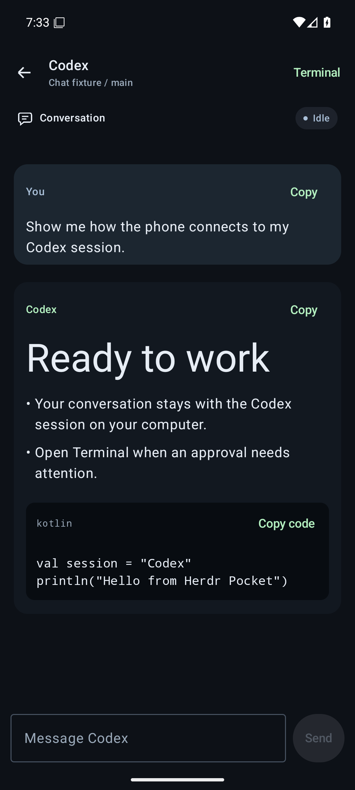
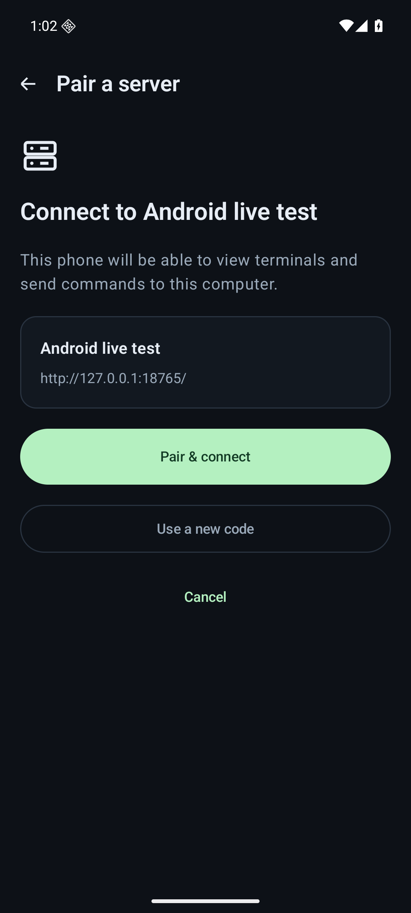
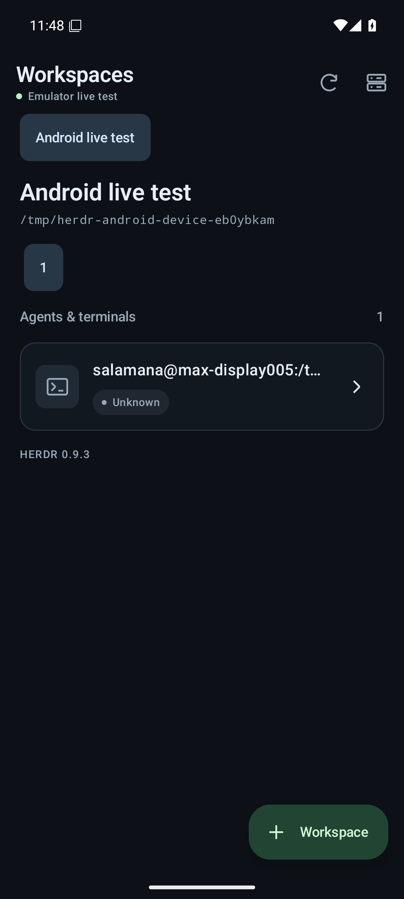

# Herdr Pocket

A native Android companion for the Herdr agents and terminals already running on your computer or server. Connect your host and phone through Tailscale, run the host installer, then scan its pairing code.

The app uses Kotlin, Jetpack Compose, and ConnectBot's native libvterm terminal component. A small authenticated companion runs beside your existing Herdr daemon. Herdr does not need to be forked or changed.

## What works

- Scan or paste a pairing invitation, review the host, and explicitly confirm pairing. Each phone receives its own revocable credential, encrypted locally with Android Keystore and excluded from backups.
- Choose a QR screenshot from the phone's gallery. The system photo picker needs no camera or storage permission; images decode locally and are never uploaded.
- Save multiple server profiles and switch between them.
- Browse workspaces, tabs, agent states, and shell panes, with agents needing input grouped together. Find sessions across a server's workspaces by name, agent, or directory. Status refreshes while the app is in the foreground.
- Open supported Codex panes in native chat: user bubbles and readable agent replies, selectable Markdown and code, date dividers and recorded message times, older conversation history, and a multiline reply box. Commands, tool results, reasoning, and injected instructions stay out of the conversation.
- Read native mathematical formulas in agent replies. Inline and display LaTeX, math fences, and unambiguous bracketed TeX render locally; copying retains the original message.
- Attach images or files, review them before Send, and remove unwanted attachments. Paste clipboard images or use a compatible keyboard's image input. Images reach Codex as image inputs; files are available to the same agent on the host.
- Choose a running conversation when Codex shares its background process across terminal tabs. Explicit selection opens existing chats without restarting them.
- Open the terminal from chat to inspect activity or answer an approval prompt. The desktop keeps control of the same agent session.
- Use a live native terminal with direct phone or hardware keyboard input, persistent pinch zoom, viewport panning, text selection, font and color settings, and focus mode.
- Use one-shot Ctrl/Alt modifiers, navigation and function keys, safe paste review, or an optional multiline command composer. Composer drafts and reused snippets wait for explicit Send; failed writes are never replayed automatically.
- Read real recent terminal output in a wrapped, selectable history viewer with search, match navigation, refresh, and copy. Each snapshot is bounded to 1,000 lines and 64 KiB.
- Save explicit device-local snippets and optionally remember acknowledged composed commands in session memory. Direct typing is never recorded as command history.
- Create workspaces, terminal tabs, and new Codex chats from the phone. New tabs inherit the workspace directory, which you can edit before creating them.
- Reconnect terminal observation after a temporary connection loss without taking the desktop's terminal controller or resizing its panes.

Requires Android 8.0+ (API 26), a running Herdr session on Linux or macOS, and Tailscale installed and signed into the same tailnet on both devices. The host companion runs as the Unix user who owns the Herdr session. The current integration targets Herdr 0.9.3.

<p>
  
  
  
  
</p>

## Install and pair

**1. Install the phone app.** Download the APK from the [releases page](https://github.com/nabil-2/herdr-android/releases) and open it on your phone. This preview is a debug-signed APK for sideloading; Android may ask you to allow installation from your browser or file manager. Keep Tailscale connected on the phone. The app uses that existing network connection and does not manage Tailscale or request its credentials.

**2. Run the host installer.** From the same release, download the asset matching your host:

| Host | Installer |
| --- | --- |
| Linux, Intel/AMD 64-bit | `herdr-pocket-setup-linux-x86_64.sh` |
| macOS, Apple Silicon | `herdr-pocket-setup-macos-arm64.sh` |
| macOS, Intel | `herdr-pocket-setup-macos-x86_64.sh` |

For example, open a host terminal in the download directory and run:

```sh
bash herdr-pocket-setup-linux-x86_64.sh
```

Use the matching filename on macOS. Run it as your normal user, without `sudo`. The installer includes its runtime, so Python and Git are not required. Herdr and Tailscale must already be installed and running. If you have several Herdr sessions, setup asks you to choose one.

Setup installs a background companion for that session, keeps its HTTP listener on loopback, and configures private [Tailscale Serve](https://tailscale.com/docs/features/tailscale-serve) HTTPS on an unused port starting at 8443. It preserves existing Serve endpoints. Tailscale may print a one-time HTTPS approval URL; follow that prompt. Your tailnet's access rules must allow the phone to reach the selected host and port.

Linux setup requires a working systemd user service manager. It attempts to enable user lingering so the companion can start at boot and stay running after logout; if your system denies that, an administrator must enable lingering for unattended access. macOS setup installs a LaunchAgent that starts at login and runs while that user is logged in. Herdr must remain running independently.

**3. Pair the phone.** Setup displays a QR code. In Herdr Pocket, tap **Scan pairing code**, allow camera access, review the host name and HTTPS address, then tap **Pair & connect**. The scanner decodes locally and does not save or upload camera images. On Android 17 and later, allow **Local network** access when connecting. If denied, enable it in Android's app settings before reconnecting.

If scanning is inconvenient, run the following on the host and paste the complete JSON into **Paste pairing code** in the app:

```sh
~/.local/bin/herdr-pocket pair --plain
```

To use a screenshot or downloaded image instead, export a fresh pairing QR:

```sh
~/.local/bin/herdr-pocket pair --qr-file ~/herdr-pocket-pairing.png
```

Open that PNG on your computer or transfer it to your phone, then tap **Choose QR screenshot** in Herdr Pocket. Review the server and tap **Pair & connect**. You can also use `herdr-pocket pair` to display the QR directly in a terminal. QR images contain a one-use invitation and expire after five minutes; generate a fresh image when needed.

Each code expires after five minutes and pairs one phone. It is exchanged for a separate device credential; you never need to copy the host's permanent owner token. If a code expires or has already been used, generate a new one. After connecting, choose a workspace, tab, and pane. Supported Codex sessions open as chat; shell panes and other agents open as terminals.

## Terminal sessions

The 0.4 preview adds direct typing and recent output history. Upgrade both the phone APK and host installer to use them; older hosts retain the command composer and special keys. You can keep your existing paired profile.

Tap the terminal or **Keyboard** to type directly into the selected session. Enter submits to the running shell or agent immediately. The compact key row provides Escape, Tab, arrows, Enter, and one-shot **Ctrl** and **Alt** modifiers; **More** opens navigation, function keys, and common shortcuts. A hardware keyboard uses the same input path. Tap the session title to switch panes without changing the desktop's selected pane.

Terminals fit the phone's width by default. In Codex terminals, vertical swipes send page-up/page-down through the scoped input queue; tap **Read** to use local output history instead. Shells use local history by default, with **Scroll** available for fullscreen programs. Pinch to change the local font size, swipe vertically to read output, and hold to select text. **Live** returns to current output. In the **⋮** tools menu, **Appearance** offers font sizes, four color themes, **Fit all columns**, and viewport reset. **Focus mode** removes the main header. These controls affect the phone's display and preserve the desktop terminal's size.

Use **Compose command** when you want to review or edit a multiline command or agent prompt first. **Enter after send** controls whether Send submits the text. **Paste** previews clipboard text; a single line can be inserted without Enter, while multiline text opens Compose. Saved snippets and recent composed commands are inserted into the draft for review. Snippets persist on this device until deleted. **Remember composed commands** is off by default, stores only acknowledged composer sends in session memory, and clears that history when switched off. Unsent drafts stay in memory while the terminal is open. If delivery becomes uncertain, review the terminal and use **Resume typing**; pending input is discarded and is never retried automatically.

Open **Output history** in the tools menu to read recent output from the actual Herdr pane. It loads up to 1,000 lines and 64 KiB as wrapped text, with selection, **Find in loaded output**, previous/next matches, and **Copy loaded output**. **Refresh** reads a new snapshot; this viewer does not poll. It marks truncated results when older output was omitted, and clears loaded text when closed or backgrounded. The live terminal remains a view of the current remote grid.

## Codex chat and upgrades

Install the APK and host installer from the same preview release. To upgrade an existing installation, open the new APK and rerun the matching host installer. Existing phone profiles, device credentials, and the selected host address are preserved; another pairing is unnecessary. Choose the same Herdr session if setup offers a session list.

Chat needs an installed Codex CLI and a session ID reported by Herdr's Codex integration. Setup discovers Codex automatically and saves its executable and home directory for the background service. It prepares the official Herdr hooks and supports SessionStart events that contain a session ID without a local transcript path. Recognized official helpers receive a backed-up compatibility update; custom helpers remain untouched. Codex 0.162.0 is the tested version. An old bridge, missing session ID, unavailable history, or unsupported provider keeps a terminal fallback with an explanation. Existing agents are never restarted by setup.

With the 0.7 app and companion on Linux, existing terminal tabs connected to Codex's shared local daemon show **Choose a conversation**. Pick the conversation using its saved name, creation date, and short ID. The app never guesses from the working directory or latest message. Send targets the chosen loaded conversation directly, including while it is working. **Conversation** lets you change your selection. Choices must be refreshed after the running terminal or daemon changes; companion restart also clears the selection. New chats created from the phone use a separate Codex runtime so the official hook can identify their pane correctly.

Use **Image** or **File** above the composer to choose attachments, or **Paste image** for a clipboard image. Review the cards and thumbnails before Send; you can send an image without a text caption. Supported images are static PNG, JPEG, and WebP up to 16 megapixels. Each file is limited to 16 MiB, with up to eight files and 32 MiB in one message. Other image formats can be attached as files, or exported to a supported image format. System pickers grant access only to selected files. The companion keeps uploaded payloads for at most seven days after submission, or one hour if unsent, subject to its storage quota. If delivery is uncertain, inspect Terminal and clear any partial draft before acknowledging the warning and reattaching; Send never retries a file or message automatically.

On the workspace screen, tap **New tab** for a shell or **New Codex chat** for a separate conversation. Confirm the name and server directory. Codex starts in its own new tab and uses your host's installed Codex configuration and login. Its first message uses the normal chat composer once the agent is ready. Login, directory trust, and approval prompts offer **Open terminal**. Creation and first-message submission are never automatically retried; after an uncertain creation, **Refresh workspaces** lets you inspect the tabs before creating another. These actions require the 0.6.0 host companion.

The phone reads saved conversation messages once per second while chat is visible. This is message refresh, not token-by-token streaming. Codex keeps running in its original pane. With the 0.5.1 app and companion, Send accepts a message while Codex is working and updates the current task using the [Codex CLI’s Enter behavior](https://learn.chatgpt.com/docs/cli/reference#interactive-shortcuts). Herdr still checks the selected agent and its readiness before sending. Approval menus and interactive questions show a visible attention banner with **Open terminal**. Loading, pending delivery, errors, and uncertain delivery keep Send disabled; messages are never retried automatically.

Older phone versions can still read chat on the new companion and send when idle. If the updated phone connects to an older host that cannot accept messages during work, the composer asks you to update the host companion. Existing pairing and history remain compatible.

Advanced hosts can select a nonstandard installation with `herdr-pocket setup --codex-bin /absolute/path/to/codex --codex-home /absolute/path/to/codex-home`. The normal setup uses `CODEX_HOME`, or `~/.codex`. A separate saved-history reader may maintain Codex's local metadata databases. Reading and selecting chats do not submit a model turn; only explicit Send can do that.

## Update or uninstall the companion

The 0.4 CLI adds:

```sh
herdr-pocket update
herdr-pocket uninstall --session default
```

`update` fetches the latest published release, including previews, verifies its checksum, and upgrades the shared companion binary while preserving configuration and paired phones. It restarts previously running companion services and restores the previous binary if an upgrade fails. It does not update the Android APK. This repository is private, so automatic downloads need the GitHub CLI signed in with repository access (`gh auth login`). Alternatively, download the platform binary and `SHA256SUMS` into the same directory and run:

```sh
herdr-pocket update --from-file ./herdr-pocket-linux-x86_64
```

Use the matching macOS binary name on macOS. Uninstall stops and removes the selected managed service and its verified Tailscale Serve route. It keeps private settings and paired credentials for reinstallation. Add `--purge` to remove that selected instance's settings and device registry too. Herdr and the Tailscale daemon keep running. Shared binaries are retained when another instance still uses them.

To start an installed companion again, run `herdr-pocket setup` with Herdr and Tailscale running. Use `--session NAME` when selecting among sessions. On machines sharing a home directory, run these commands on the machine that owns the instance; setup records that hostname and guards its Linux service accordingly.

## Manage phone access

Generate another QR code, check the companion, list paired devices, or revoke one device using its ID from the list:

```sh
~/.local/bin/herdr-pocket pair
~/.local/bin/herdr-pocket status
~/.local/bin/herdr-pocket devices
~/.local/bin/herdr-pocket revoke-device DEVICE_ID
```

For another running Herdr session, run `~/.local/bin/herdr-pocket setup --session NAME`. Each session has its own companion, address, and device registry. Add `--session NAME` to `pair`, `status`, `devices`, and `revoke-device` when selecting among configured sessions. Revocation rejects subsequent requests and closes an active phone terminal stream.

Existing manual profiles remain supported through **Advanced: manual server setup**, or **Add server** beside existing profiles. See [host companion setup](bridge/README.md) for source installation, explicit sockets, and manual network configuration.

## Develop and test

Use Android Studio with an Android 37.0 SDK and JDK 17, or install the Android command-line tools and put the SDK path into an untracked `local.properties`:

```properties
sdk.dir=/absolute/path/to/android-sdk
```

```sh
sdkmanager 'platforms;android-37.0' 'build-tools;36.0.0' 'platform-tools'
./gradlew :app:testDebugUnitTest :app:lintDebug :app:assembleDebug
```

The Gradle wrapper verifies the distribution checksum. Native Android dependencies are pinned. The APK is generated at `app/build/outputs/apk/debug/app-debug.apk`.

With an emulator or test phone attached:

```sh
./gradlew :app:connectedDebugAndroidTest \
  -Pandroid.testInstrumentationRunnerArguments.notClass=dev.herdr.android.LiveBridgeDeviceTest
```

For host checks, install the [source environment](bridge/README.md#install-from-source), then run:

```sh
bridge/.venv/bin/python -m pytest bridge/tests -q
HERDR_INTEGRATION=1 bridge/.venv/bin/python -m pytest bridge/tests/test_live_herdr.py -q
CODEX_INTEGRATION=1 bridge/.venv/bin/python -m pytest bridge/tests/test_live_codex_chat.py -q
```

The live integration test creates and cleans up an isolated named Herdr session. It does not send commands to an existing user pane. The [Android device fixture](bridge/README.md#live-android-device-fixture) exercises the app against a real companion and Herdr shell, including host-generated QR decoding and pairing. GitHub Actions builds the APK, runs JVM/lint and host checks, and packages the supported host installers.

See [protocol](docs/protocol.md) for the app/service interface and [validation](docs/validation.md) for this preview's results. Physical camera scanning and macOS login-service behavior need testing on their respective hardware; emulator checks do not establish those results.

## Chat layout

The conversation uses compact author/time captions, right-aligned user bubbles, plain assistant text, restrained Markdown headings, and a fixed reply composer. Working appears as a quiet static caption. Disabled submission explains readiness; ordinary manually launched Codex sessions can receive messages when idle or working if the host permits it. Renaming an agent changes its display label and does not change this readiness check. Message times come from verified records for that exact saved conversation and respect the phone's time zone and 12/24-hour format. When only a turn time is available, it appears once as a turn caption. Missing message times stay empty.

Layout and behavior follow the [official Android JetChat example](https://github.com/android/compose-samples/blob/main/Jetchat/app/src/main/java/com/example/compose/jetchat/conversation/Conversation.kt), [Material typography guidance](https://m3.material.io/styles/typography/applying-type), and [Android accessibility defaults](https://developer.android.com/develop/ui/compose/accessibility/api-defaults). Copy, navigation, and Send retain accessible touch targets.

Math renders with the pinned [native LaTeX renderer](https://github.com/huarangmeng/latex/tree/release-1.5.6), without a WebView or remote rendering service. Formulas wrap to the available width where possible; unusually wide expressions can scroll horizontally. Unsupported or malformed formulas remain visible as their original source. Code, currency, and ordinary bracketed prose keep their usual Markdown behavior.

## Current limits

Status, chat refresh, and terminal observation run while the app is in the foreground; background push notifications are not implemented. Native chat supports Codex conversations and reviewed attachments; other agents, approval menus, and interactive questions use the selected terminal. Shared-daemon conversation recovery requires Linux process/socket verification; ordinary correctly reported sessions work on Linux or macOS. Saved historical attachments are shown with friendly names rather than downloaded or previewed. Output history is a bounded recent snapshot, with no paging into older terminal output. Direct SSH connections are not implemented. The host, Tailscale, and Herdr daemon must remain online. Native Windows hosts are not supported because Herdr's terminal observer requires Linux or macOS.

## License

Apache License 2.0. This is an independent companion and is not an official Herdr application. See [LICENSE](LICENSE), [NOTICE](NOTICE), and [third-party notices](THIRD_PARTY_NOTICES.md).
