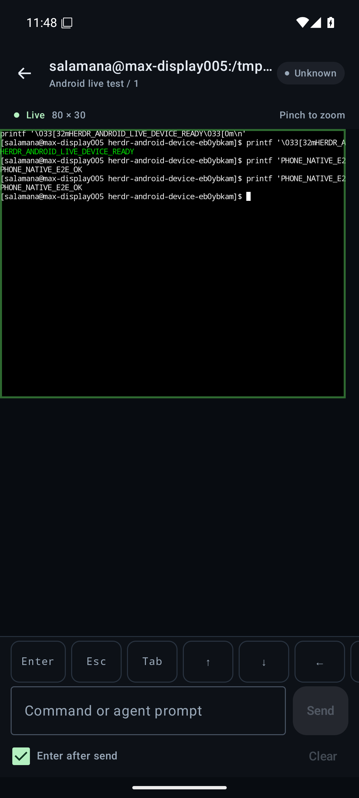

# Herdr Pocket

A native Android companion for the Herdr agents and terminals already running on your computer or server. Connect the host and phone to Tailscale, then open your work from your phone.

The app is written in Kotlin and Jetpack Compose. Terminal rendering uses ConnectBot's native libvterm-backed terminal component. There is no WebView, browser wrapper, or Herdr fork. A small authenticated Python bridge runs next to the existing Herdr daemon.

## What works

- Save multiple server profiles and switch between them. Access tokens are encrypted using Android Keystore, excluded from backups, and sent only in Authorization headers.
- Browse workspaces, tabs, agent states, and shell panes. Status refreshes while the app is in the foreground.
- Watch live ANSI terminal output, including colors, cursor movement, and agent terminal interfaces.
- Send literal text with optional Enter, or use the Enter, Escape, Tab, arrow and Ctrl+C controls. Typing a draft does not send it. Failed sends retain the draft and are never replayed automatically.
- Create a workspace on the host, then launch an agent from its shell.
- Reconnect terminal observation after a temporary connection loss without taking the desktop's terminal controller or resizing its panes.

Requires Android 8.0+ (API 26). The companion service requires Python 3.11+, Linux or macOS, and Herdr 0.9.3. Connect it to a running Herdr session as the same Unix user that owns the session.

<p>
  
  
</p>

## Install the Android app

Download the APK from this repository's [preview releases](https://github.com/nabil-2/herdr-android/releases). The initial preview is a debug-signed APK intended for sideloading; it is not an app-store release. Android may ask you to allow installation from the browser or file manager you use.

Install Tailscale on your phone and sign into the same tailnet as your host. The app uses that existing network connection and does not manage Tailscale or request your Tailscale credentials.

On Android 17 and later, allow the **Local network** permission when connecting. If you deny it, enable it in Android's app settings before reconnecting.

## Start the host companion

Clone this repository on the machine where Herdr is running. From its root:

```sh
python3 -m venv bridge/.venv
bridge/.venv/bin/python -m pip install -r bridge/requirements.lock
bridge/.venv/bin/python -m pip install --no-deps -e ./bridge
bridge/.venv/bin/herdr-android-bridge init-token
bridge/.venv/bin/herdr-android-bridge serve
```

Copy the token printed by `init-token` into the Android app's server profile. It is stored in `~/.config/herdr-android/token` with owner-only permissions. Keep the bridge terminal running; closing the companion stops phone access but does not stop Herdr's agents. See [bridge setup](bridge/README.md) for named sessions and explicit socket paths.

In a second host terminal, expose the loopback service privately through Tailscale:

```sh
tailscale serve --bg http://127.0.0.1:8765
tailscale serve status
```

Use the HTTPS address printed by Tailscale, such as `https://my-host.my-tailnet.ts.net`. [Tailscale Serve](https://tailscale.com/docs/features/tailscale-serve) may prompt you to enable HTTPS for your tailnet. Tailnet access rules must allow your phone to reach this host. Serve keeps this endpoint inside your tailnet.

Open **Herdr Pocket → Add server** and enter a display name, that HTTPS URL, and the bridge token. Tap **Save & connect**, then choose a workspace, tab and pane. Sending a prompt to an agent uses the same running terminal you see on your desktop. The companion token grants control of the selected Herdr session.

For direct private-network development, the app also accepts HTTP on numeric Tailscale addresses (`100.64.0.0/10` or `fd7a:115c:a1e0::/48`) and loopback. To use a direct Tailscale IP, bind the bridge to that specific IP using `--host`, then enter `http://100.x.y.z:8765`. HTTPS with Serve is the default setup. Arbitrary HTTP hosts, credentials inside URLs, redirects, and untrusted TLS certificates are rejected.

## Develop and test

Use Android Studio with an Android 37.0 SDK and JDK 17, or install the Android command-line tools and put the SDK path into an untracked `local.properties`:

```properties
sdk.dir=/absolute/path/to/android-sdk
```

```sh
sdkmanager 'platforms;android-37.0' 'build-tools;36.0.0' 'platform-tools'
./gradlew :app:testDebugUnitTest :app:lintDebug :app:assembleDebug
```

The Gradle wrapper verifies the distribution checksum. Native Android dependencies are pinned. The APK is generated at `app/build/outputs/apk/debug/app-debug.apk`.

With an emulator or test phone attached:

```sh
./gradlew :app:connectedDebugAndroidTest
```

Bridge checks:

```sh
bridge/.venv/bin/python -m pip install -e './bridge[test]'
bridge/.venv/bin/python -m pytest bridge/tests -q
HERDR_INTEGRATION=1 bridge/.venv/bin/python -m pytest bridge/tests/test_live_herdr.py -q
```

The live integration test creates and cleans up an isolated named Herdr session. It does not send commands to an existing user pane. The [live Android fixture](bridge/README.md#live-android-device-fixture) also tests the native app against a real bridge and Herdr shell. GitHub Actions builds the APK and runs Android JVM/lint and bridge checks on pushes.

See [protocol](docs/protocol.md) for the app/service interface and [validation](docs/validation.md) for this preview's results.

## Current limits

The preview has foreground status and terminal observation; background push notifications are not implemented. The app sends input through the selected pane's terminal, rather than interpreting agent-specific approval menus. Remote terminal scrollback and direct SSH connections are not implemented. The host and Herdr daemon must remain online. Native Windows hosts are not supported by this first companion because Herdr's terminal observer requires Linux or macOS.

## License

Apache License 2.0. This is an independent companion and is not an official Herdr application. See [LICENSE](LICENSE), [NOTICE](NOTICE), and [third-party notices](THIRD_PARTY_NOTICES.md).
