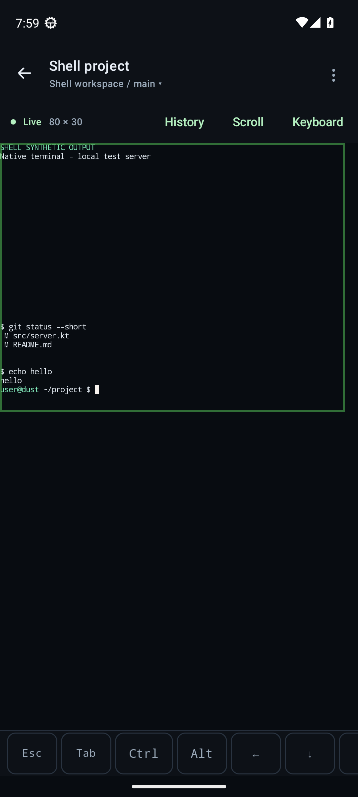
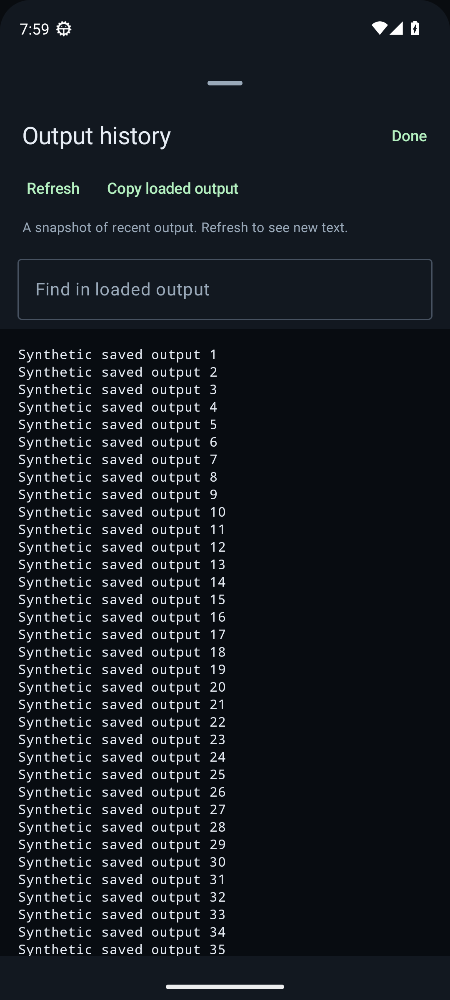
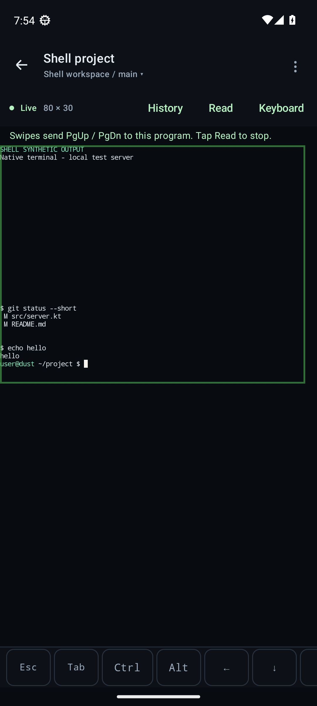

# Preview 0.6.0 validation

Validated on 9 October 2026. This release adds terminal tabs and new Codex chats from Android, recorded message times, Codex session-report compatibility, width fitting, stable full-frame rendering, and terminal scrolling. The previous TLS and working-state Send fixes are retained. The [0.5.1 report](validation-0.5.1.md) records the earlier release.

## Results

| Check | Result | Coverage |
| --- | --- | --- |
| Android JVM | 132 passed | Strict creation acknowledgements, fresh-chat readiness, message times, frame deduplication, paging encoders, retained pairing/chat/terminal guards |
| Android lint | 0 errors, 19 warnings | App, tests and terminal dependency; source text scan described below |
| Bridge offline | 467 passed | Scoped tab/agent creation, shell readiness, fresh receipts, timestamp provenance, official helper compatibility, existing authentication/pairing/input/host management |
| Actual Codex 0.162 | 7 passed | Legacy/paginated histories, 54 duplicate messages across midnight, append/rollback, persisted times, and fresh reader continuity; no model calls |
| Actual Herdr 0.9.3 | 5 passed | Owned shell, unnamed/renamed working synthetic agents, new managed Codex launch and first message, canonical ID-only SessionStart reporting |
| Android 13 device | 82 passed | Chat, creation, uncertainty inspection, terminal fit/scroll/input and retained real TLS regressions |
| Frozen Linux package | Passed | Authenticated API, clean Codex history, single-use pairing/revocation, frozen QR helpers and bundled licenses |
| Linux/macOS CI packages | Passed | Linux x86_64, macOS arm64 and macOS x86_64 packages and smoke checks |
| Installed 005 companion | Passed | Checksummed 0.5.1→0.6.0 update; expected capabilities; all companion configuration/device files and Codex config byte-identical |
| Normal Android update | Passed | Files/PackageInstaller update from 0.5.1 with stable signing identity and retained app data |

These are **693 distinct automated passing cases**, plus package, installed-host, artifact and delivery checks. The 79 ordinary device cases passed unchanged in 136.96 seconds; the three isolated live Android cases passed in 13.10 seconds with QR decode/pairing and real shell control. One earlier full run crashed during Compose 1.12.1 Activity destruction; the unchanged five-case terminal class and full suite then passed. Read-only review found no preceding app/network exception or app-owned modifier lifecycle call; no speculative production workaround was added. The focused seven terminal-reading cases also passed, including both outer columns with font scale 1.8.

The offline run skips 12 opt-in real-runtime cases, which passed separately. A combined real-runtime run reported 40 passes, including 28 helper cases already counted offline. Tests use owned UUID Herdr sessions, temporary Codex homes, synthetic conversations and fake interactive agents; no existing user agent received test input and no user conversation was read for testing.

## Creation and Codex identity

Activity tests create a terminal tab and a Codex chat in the selected workspace, check the editable working directory, disable a second Create while acknowledgement is pending, and send one first message through the new chat composer. Additional tests lose a creation acknowledgement or return an already-existing pane ID; automatic polling does not unlock another creation. Explicit **Refresh workspaces** requires successful inspection before another attempt.

The real Herdr launch test exposed a race between tab creation and shell startup. The companion now polls only read-only metadata for up to three seconds before calling `agent.start` once in the new pane. Confirmation failures retain the created tab and advise inspecting Terminal. Creation, launch and prompts never retry automatically.

Codex 0.162 can emit a canonical SessionStart ID with no transcript path, while Herdr's official v8 helper ignores that event. The companion recognizes the complete pinned official helper, saves an owner-only original backup, and changes only its exact session-event guards. Official hook registration and `features.hooks` are verified; unrelated settings and custom helpers are preserved. The real hook test proves a new exact ID replaces a stale ID only in its owned pane. Existing unattributed panes are never matched by directory, title or newest file.

A fresh Codex process may defer saving its rollout until its first message. A short-lived, in-memory receipt bound to an acknowledged new launch permits an empty composer after a specific completed not-persisted RPC reply or a verified zero-turn saved thread. Exact pane/session/terminal identity and managed readiness remain required. The receipt is consumed before submission; Android independently pauses uncertain delivery. This is not durable server-side deduplication across restart/cache eviction.

## Recorded message times

Structured `thread/read` remains the sole content source. A bounded worker optionally matches recorded timestamps from that exact thread's verified owner-only rollout inside its configured Codex home. It rejects unsafe paths, mismatched identity, ambiguous records and unsupported shapes. Duplicate messages remain distinct. The actual Codex tests cover both history formats, more than one page, same-turn repeats, midnight, append and rollback.

Android displays each available recorded message time with the phone's time zone and 12/24-hour setting. If only a turn boundary time exists, one turn caption replaces repeated per-message times. Missing timing stays empty. Timing enrichment preserves previously loaded history pages.

## Terminal behavior

Full frames reset and repaint in one native emulator write; identical full frames are skipped, avoiding a separately rendered blank reset. Fit width is the default and migrates the old default once. Fitting measures the actual monospace paint/font scale and leaves desktop geometry unchanged. Device checks draw synthetic markers in columns 1 and 80 at large system text size and require both to fit.

Vertical swipes can read local scrollback; **Live** returns to the current viewport. Codex panes default to bounded explicit PgUp/PgDn gestures because Herdr 0.9.3's observer strips mouse/alternate-screen advertisements. **Read** uses local history instead. Shell panes default to reading, and the mode resets per observer. Page keys use raw encoding because Herdr has no logical aliases for them. All gesture input uses the existing scoped FIFO, composition, refusal and uncertain-delivery guards. Emulator replies never become remote input.

Herdr recent output remains bounded to 1,000 lines and 64 KiB. The actual observer probe showed fullscreen output can expose only the current viewport, so the UI explains that limit and offers program paging rather than claiming unlimited scrollback.

<p>
  
  
  
</p>

The terminal dependency's Kotlin sources are pinned and vendored solely to expose its existing ScrollController/accessibility component; the four-ABI native libraries remain byte-identical to 0.5.1. See [vendor notes](../third_party/termlib/README.md). AGP's BidirectionalText lint detector hung walking this dependency's Kotlin comments. Only that detector is disabled in the dependency module; mandatory strict UTF-8/bidirectional-control scanning covers its Kotlin/XML inputs on build and lint. Other app/dependency checks remain enabled.

## Environment and artifact

- Pixel 7 emulator, Android 13/API 33, x86_64, hardware virtualization.
- JDK 17, Kotlin 2.4.20, Gradle 9.6.0, Android Gradle Plugin 9.4.0; compile/target SDK 37.0, build tools 36.0.0; minimum API 26.
- Linux x86_64 package: glibc 2.34, portable Python 3.11.17, PyInstaller 6.22.3.
- APK: **31,590,475 bytes**, version code **8**, version name **0.6.0**. API 33 signature, ZIP CRC/no duplicates and 16 KiB alignment checks passed. All 16 native libraries across four ABIs match 0.5.1 byte-for-byte.

APK SHA-256:

```text
98923777d8c82fe0b53fb57a65236ddb24d041e51c9c41af31384e4619a6c373
```

Production source is `4a5f49726cad4e9ae10939126118d1634941d037`. [Host package CI](https://github.com/nabil-2/herdr-android/actions/runs/37969199195) passed all three platforms. [Android/bridge CI](https://github.com/nabil-2/herdr-android/actions/runs/37969199201) also passed. The normal API 33 Files/PackageInstaller update confirmed **App installed**, retained an app-private synthetic marker, installed the exact APK hash above, and launched successfully. Later documentation/screenshots only record these results.

Private APK delivery was verified through Tailscale HTTPS with normal CA/hostname checks: HTTP 200, APK MIME, all 31,590,475 bytes and the exact SHA-256. This avoids an unauthenticated private-GitHub download returning HTML instead of an APK. The 005 companion exposes its new capabilities and keeps all configuration/device files byte-identical; the recognized helper backup matches the pinned original.

The signing certificate is unchanged (`ad045612a56a05953afb2162ac0b277a8a579dd8e70269caa18db37c26125c9c`). Release assets and platform license bundles are covered by SHA256SUMS. Phone profiles and host credentials do not need to be recreated.

## Repeat

```sh
./gradlew --no-daemon :app:testDebugUnitTest :app:lintDebug :app:assembleDebug :app:assembleDebugAndroidTest
./gradlew :app:connectedDebugAndroidTest \
  -Pandroid.testInstrumentationRunnerArguments.notClass=dev.herdr.android.LiveBridgeDeviceTest
bridge/.venv/bin/python -m pytest bridge/tests -q
HERDR_INTEGRATION=1 CODEX_INTEGRATION=1 bridge/.venv/bin/python -m pytest \
  bridge/tests/test_live_herdr.py bridge/tests/test_live_busy_codex.py \
  bridge/tests/test_live_codex_chat.py bridge/tests/test_live_fresh_reader.py \
  bridge/tests/test_live_new_codex.py bridge/tests/test_codex_integration.py -q
bridge/.venv/bin/python scripts/build_host.py
bridge/.venv/bin/python scripts/smoke_host_package.py artifacts/host/herdr-pocket-linux-x86_64
```

Use the [owned live Android fixture](../bridge/README.md#live-android-device-fixture) for the three optional end-to-end cases. Its one-use invitation expires after five minutes.

## Practical limits

Chat refreshes persisted text rather than streaming tokens; tool/reasoning output is omitted and approvals use Terminal. Login/trust prompts can require the new Codex chat's terminal. Recorded message times may be unavailable in old or unsupported histories. Background notifications and direct SSH are not included. The user's physical phone and macOS login services have not been tested directly; emulator and CI evidence do not establish those hardware results. Herdr and Tailscale run independently.
