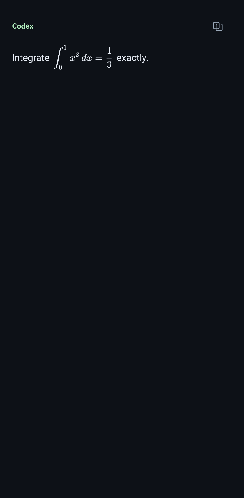
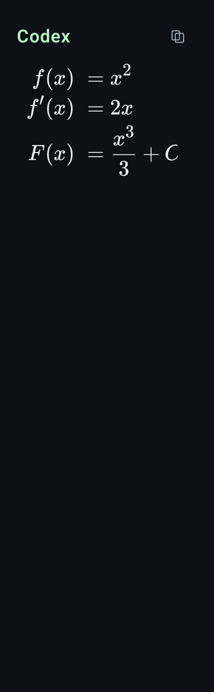
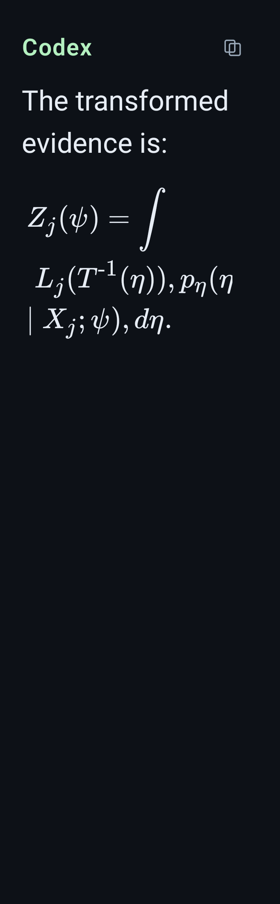
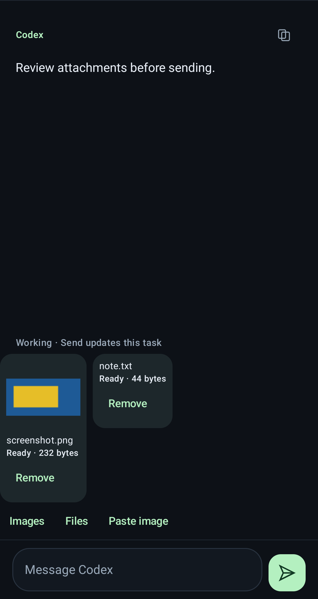

# Preview 0.7.0 validation

Validated on 10 October 2026. This release adds native mathematical formulas, existing shared-daemon Codex conversation selection, and reviewed image/file attachments. The [0.6.0 report](validation-0.6.0.md) records the earlier terminal and creation work.

## Results

| Check | Result | Coverage |
| --- | --- | --- |
| Android JVM | 179 passed | Conservative math recognition, bounded renderer inputs, strict selection/attachment protocols, upload send-once behavior, authoritative uncertainty restoration, retained chat/terminal/connection guards |
| Android lint | 0 errors, 22 warnings, 2 hints | App, tests and terminal dependency; existing strict source-text scan retained |
| Bridge offline | 570 passed | Explicit runtime-bound selection, daemon WebSocket reads/steering, upload validation/quotas, durable uncertainty, scoped display names, existing authentication/creation/pairing |
| Actual Codex/Herdr integrations | 13 passed | Isolated real Codex saved histories and owned Herdr shell/hooks/new-chat/attachment input; no model prompts |
| Android 13 device | 99 passed | 96 ordinary UI cases and three owned live pairing/terminal cases |
| Frozen Linux package | Passed | PNG/JPEG/WebP and generic-file uploads, authentication, clean history, single-use pairing, revocation, frozen QR helpers and bundled licenses |
| Linux/macOS package CI | Passed | Linux x86_64, macOS arm64 and macOS x86_64 builds, codec smoke and artifact uploads |
| Installed 005 companion | Passed | Checksummed 0.6.0→0.7.0 update, expected capabilities, current conversation offered from both terminal panes |
| Normal Android update | Passed | Files/PackageInstaller 0.6.0→0.7.0 upgrade, retained private app data, exact installed APK hash and successful launch |

These are **861 distinct automated passing cases**, plus artifact, installed-host, package and delivery checks. The ordinary 95-case device suite passed in 169.792 seconds. One additional regression using the exact reported integral passed in 3.103 seconds; the three live Android cases passed in 13.001 seconds. The final full run had no transient crash. Offline checks skip the 13 opt-in integrations, which passed separately. All test conversations and file/image payloads are synthetic; real-runtime checks use owned UUID Herdr sessions and temporary Codex homes. No test input was sent to an existing user agent, and actual user histories were not used as fixtures.

## Native mathematical formulas

Assistant math is extracted before Markdown parsing and rendered with huarangmeng/latex 1.5.6 and bundled KaTeX fonts. Device tests require visible nonblank native pixels, rather than only a semantic placeholder. Coverage includes integrals, Greek letters, fractions, radicals, superscripts/subscripts, aligned rows, math fences, plain bracketed TeX, real multiline display source, unsupported/malformed input, currency, code and literal user messages. Copy retains the complete original Markdown/LaTeX.

The exact reported evidence integral was tested at 260 dp with font scale 1.8. Its integral, inverse, Greek symbols and subscripts render natively. Formulas wrap where the renderer supports breaks; a wide atom can scroll horizontally within the phone viewport. Unsupported and oversized math stays readable. Device checks exposed and fixed both newline-spanning placeholders disappearing and unclaimed GFM math nodes dropping currency/oversized source.

<p>
  
  
  
</p>

## Existing shared Codex conversations

Codex 0.162's shared background app-server inherits its first terminal's Herdr environment. That hook identity cannot establish which conversation another terminal displays. The companion verifies the foreground TUI, process/start lifetime, owned daemon/socket/home and Linux Unix-socket peer relationship, then offers explicit loaded primary conversations. It never chooses from a directory, message preview or newest file. Choices are scoped to one credential and exact runtime; tokens expire after five minutes. Loaded IDs are scanned across at most eight 32-ID pages, with at most 32 eligible displayed choices.

The current conversation was verified as offered through the installed 005 API from both relevant panes, using metadata only. Device tests cover deliberate selection, exact thread/token submission, lost/expired selection recovery and no automatic choice. Backend tests cover cross-device isolation, stale hook exclusion, changed runtimes, paged subagents, blocked chats, exact active-turn steering, image inputs, uncertain acknowledgements and no PTY fallback. New managed chats use `--no-daemon`; the recognized official helper receives an ancestry guard on Linux. macOS retains its existing canonical pane-local hook flow without attempting Linux process verification.

Selected reads connect to the existing daemon over its official Unix WebSocket transport. Explicit Send uses the selected thread's `turn/start` or `turn/steer` with its active turn ID. Existing frontend listeners remain attached. Approval/tool questions remain in Terminal. The ordinary saved-history sidecar allowlist stays read-only. See [identity notes and pinned sources](codex-session-selection.md).

## Reviewed attachments

Native system pickers, clipboard image paste and actual Android `InputConnection.commitContent` were exercised against the real MainActivity. Tests verify image-only Send, image/file preview and removal, exact uploaded bytes and IDs, one submission, acknowledgement clearing, invalid image handling, picker backgrounding and rejection of stale targets. The editor uses Compose's state-based text field so a compatible keyboard receives image MIME support. Input sessions reset when profile, pane or conversation changes.

The server validates static PNG/JPEG/WebP with Pillow; generic files remain available to the same agent through generated owner-private paths. Limits are 16 MiB/file, 16 megapixels/image, eight files and 32 MiB/Send. Tests cover actual codecs, MIME mismatch, symlinks, changed bytes, scope changes, cross-device IDs, cancellation, limits and cleanup. Uploaded bytes alone never type. The owned real Herdr test confirms two separate no-Enter bracketed image pastes followed by one reviewed file prompt and one Enter. Selected shared-daemon chats use typed local-image inputs and no PTY writes.

IDs are consumed before input. Durable fsynced markers preserve uncertain partial delivery across companion restart, scoped to credential/pane/thread/runtime independently of a temporary binding. Only confirmed delivery or explicit inspection acknowledgement clears that credential's marker. Restart cannot resurrect consumed IDs. Payloads expire after one hour unsent or seven days submitted; bounded display-only records retain readable own attachment names. The native draft store cannot override an authoritative server uncertainty gate.

<p></p>

## Artifact and installed host

- Pixel 7 emulator, Android 13/API 33, x86_64, hardware virtualization.
- JDK 17, Kotlin 2.4.20, Gradle 9.6.0, Android Gradle Plugin 9.4.0; compile/target SDK 37.0, build tools 36.0.0; minimum API 26.
- APK: **32,652,983 bytes**, version code **9**, name **0.7.0**. Signature and 16 KiB alignment checks pass. All 16 native libraries remain byte-identical to 0.6.0; the production APK excludes the synthetic test provider. Math fonts and both MIT notices are included.
- Linux package: portable Python 3.11.17, PyInstaller 6.22.3; frozen codec smoke passes.
- 005 configuration, device registry, owner token and Codex configuration remain byte-identical after upgrade. Only the recognized compatibility helper changed; its original backup remains intact. Existing Tailscale routes and paired profiles are preserved.

APK SHA-256:

```text
29e5da3310ac156cc4ac61ff516b2d72ac6187391898a40e83c09ce2e4c99346
```

Linux companion SHA-256:

```text
df9f8ab37162b9e0b2ad88c3c3646876aad8e01cadf2d2ee67a08f48f9b61f38
```

The signing certificate is unchanged: `ad045612a56a05953afb2162ac0b277a8a579dd8e70269caa18db37c26125c9c`. Private Tailscale HTTPS delivery was verified with normal CA/hostname checks, HTTP 200, APK MIME, the complete 32,652,983 bytes and the exact APK hash.

Production source is `8bdc2de0168525bfa12c5a6ffa4089e3f3cb5598`. [Host package CI](https://github.com/nabil-2/herdr-android/actions/runs/38027374023) passed all three platforms, including actual frozen codecs. [Android/bridge CI](https://github.com/nabil-2/herdr-android/actions/runs/38027374085) also passed. Earlier CI failures were isolated test assumptions: requiring a Linux probe on macOS and expecting a real private daemon directory on a clean runner. Both were corrected in fixtures; the packaged codecs and Android build were already passing.

The API 33 normal Files/PackageInstaller update confirmed **App installed**, retained an app-private synthetic marker, installed the exact APK hash above and launched successfully. The retained 0.6.0 fixture data also retained its already-audited saved crash diagnostic from 9 October; that old record was cleared through the app UI. No new exception occurred in the final UI run or installation. Later documentation changes only record these results.

## Repeat

```sh
./gradlew :app:testDebugUnitTest :app:lintDebug :app:assembleDebug :app:assembleDebugAndroidTest
./gradlew :app:connectedDebugAndroidTest \
  -Pandroid.testInstrumentationRunnerArguments.notClass=dev.herdr.android.LiveBridgeDeviceTest
bridge/.venv/bin/python -m pytest bridge/tests -q
HERDR_INTEGRATION=1 CODEX_INTEGRATION=1 bridge/.venv/bin/python -m pytest \
  bridge/tests/test_live_*.py \
  bridge/tests/test_codex_integration.py::test_null_transcript_hook_replaces_only_owned_exact_codex_session -q
bridge/.venv/bin/python scripts/build_host.py
bridge/.venv/bin/python scripts/smoke_host_package.py artifacts/host/herdr-pocket-linux-x86_64
```

The live Android fixture also accepts a private attachment directory and temporary Codex home, so maintenance cannot inspect existing user uploads. The host smoke permits the Linux process-metadata probe only on Linux. The arbitrary socket-alias test creates its own temporary daemon directory instead of depending on a local real Codex daemon.
